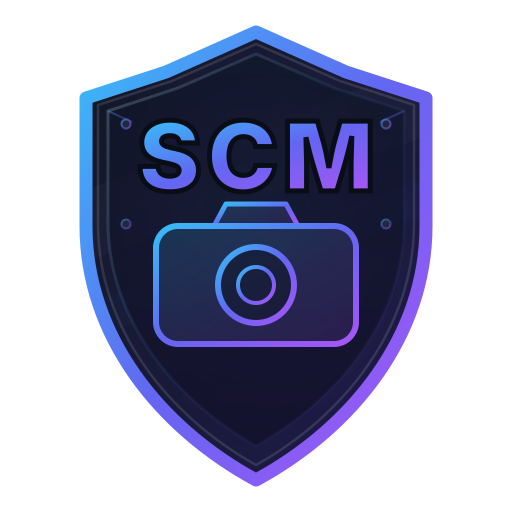

# Streamer Censoring Multitool (SCM)



A local, experimental Windows and OBS streaming safety utility created by
[Intzevidis7](https://github.com/Intzevidis7).

**Streamer Censoring Multitool (SCM)** combines offline **Vosk** speech
recognition, an optional **AI audio keyword model**, **desktop/music audio
monitoring**, and **OBS webcam blur/restore guards** (`YOLOE` substance/smoke
detection and `NudeNet` exposure detection) to help protect live streams from
accidental profanity, substance/smoke visuals, and exposure violations[cite: 10].

When you enable **Enable AI audio keyword model** for the first time, the app
automatically downloads the required XLS-R encoder into:

```text
models/keyword_v4/pretrained/
```[cite: 10]

The app runs locally on your PC and does not require a cloud transcription
account[cite: 10]. Microphone audio and webcam frames are processed locally, and
detections/transcripts appear in the app log[cite: 10].

> Important: This is not a guaranteed content-safety or ban-prevention filter.
> It can miss detections, trigger false beeps or blurs, or react late. Always
> test with a local OBS recording before streaming[cite: 10].

## How the Modules Work Together

SCM can run **Vosk**, the **AI audio keyword model**, **desktop/music
monitoring**, and **OBS vision guards** together[cite: 10]:

| System | What it does | When it triggers |
| --- | --- | --- |
| Vosk speech censor | Converts speech to text and matches entries in active Greek, Greeklish, or English word lists | When a listed word is recognized in the delayed mic stream[cite: 10] |
| AI audio keyword model | Analyzes 2-second, 16 kHz mono audio windows directly from sound | When a target reaches the configured confidence threshold (default `0.65`)[cite: 10] |
| Censor engine | Delays microphone audio and inserts a beep | When either Vosk or the AI audio model detects a target[cite: 10] |
| Desktop / music monitor | Monitors desktop loopback audio alongside active stream guards | When desktop/music monitoring is enabled in settings |
| Vision guard (`YOLOE` + `NudeNet`) | Monitors an OBS camera source (or local webcam) for restricted items/smoke and explicit exposure | When a restricted object/smoke or exposure class persists past its threshold, blurring/hiding the source in OBS |

If both Vosk and the AI audio model detect the same speech, overlapping audio
is beeped only once[cite: 10].

## Quick Start

### What Users Need

- Windows PC with [OBS Studio](https://obsproject.com/download) (with OBS WebSocket enabled if using OBS camera blur/restore)[cite: 10]
- [VB-CABLE](https://vb-audio.com/Cable/), installed separately, if routing processed microphone audio into OBS[cite: 10]
- SCM release installer or source/build setup, plus internet access for first-time model downloads and several GB of free disk space[cite: 10]

End users do **not** need Python, Inno Setup, source files, or the GitHub
“Source code (zip)” archive when using a release installer[cite: 10].

### Windows SmartScreen Warning

If a release installer is **not code-signed**, Windows may display:

> Windows protected your PC  
> Microsoft Defender SmartScreen prevented an unrecognized app from starting.  
> App: SCM-Setup.exe  
> Publisher: Unknown publisher[cite: 10]

This means Windows cannot verify the publisher of the EXE and has not
established reputation for a new download[cite: 10]. Only continue if you
intentionally downloaded the file from this project's official GitHub Release
and trust the project[cite: 10]. If you choose to continue, click **More info
→ Run anyway** rather than disabling SmartScreen system-wide[cite: 10].

### Speech Recognition Modes

- **Greek only — fastest for Greek streams:** loads the Greek Vosk model and uses `bad_words_el.txt` plus `bad_words_greeklish.txt`[cite: 10].
- **English only — fastest for English streams:** loads the English Vosk model and uses `bad_words_en.txt`[cite: 10].
- **Greek + English — mixed speech, higher CPU use:** loads both recognizers and uses all three language lists[cite: 10].

For Greek-focused streams, use **Greek only** to avoid loading the English
recognizer and reduce memory usage[cite: 10]. The language lists are editable
UTF-8 files:

```text
bad_words_el.txt
bad_words_en.txt
bad_words_greeklish.txt
```[cite: 10]

Stop and restart censoring after editing a word list[cite: 10].

## Enable AI Audio Detection

The AI audio keyword model is optional; when disabled, voice censoring uses
only the selected Vosk recognizer(s)[cite: 10]:

1. Open **Streamer Censoring Multitool (SCM)**[cite: 10].
2. Enable **AI audio keyword model**[cite: 10].
3. Start censoring and wait on the first AI-enabled run while XLS-R downloads into `models/keyword_v4/pretrained/`[cite: 10].

The detector analyzes a 2-second, 16 kHz mono audio window every 0.25 seconds
(automatically resampling 44.1 kHz streams to 16 kHz), using a default
confidence threshold of `0.65`, beeping the most recent 0.45 seconds of audio,
and suppressing repeated detections of the same label for 0.7 seconds[cite: 10].

## Installation & Setup

1. Install [VB-CABLE](https://vb-audio.com/Cable/) (a reboot may be required) and [OBS Studio](https://obsproject.com/download)[cite: 10].
2. Install or extract **SCM** and download/place the required Vosk models (`vosk-model-el-gr-0.7` and/or `vosk-model-small-en-us-0.15`) and vision weights (`custom_guard_world.pt` / `yoloe-11l-seg.pt`)[cite: 10, 11].
3. Open **SCM**, select your microphone by full device name, and choose **CABLE Input (VB-Audio Virtual Cable)** as your processed audio output[cite: 10].
4. If using OBS webcam blur/restore, configure OBS WebSocket connection details in SCM and verify your target OBS camera source name[cite: 10].

## Configure OBS

**Only the microphone is delayed by the audio censor[cite: 10].** SCM does not
automatically delay webcam video, game video, or game audio to match mic delay[cite: 10].

1. Add an **Audio Input Capture** source in OBS set to **CABLE Output (VB-Audio Virtual Cable)**[cite: 10].
2. Mute or remove every raw microphone route (OBS `Settings → Audio → Mic/Aux`, webcam mics, duplicate scene mic sources, or mixer/Sonar routes) so uncensored audio cannot leak into the stream[cite: 10].
3. Keep your webcam/camera source filter or visibility setup ready for OBS blur/hide actions triggered by the vision guard[cite: 10].

**Routing summary:** SCM sends processed mic audio to `CABLE Input`; OBS
receives it from `CABLE Output`[cite: 10].

## Test Before Streaming

1. Start SCM and begin monitoring/censoring; wait until status shows active/running[cite: 10].
2. In OBS, click **Start Recording** (not **Start Streaming**)[cite: 10].
3. Test normal speech, target list words, optional AI audio triggers, and camera test frames[cite: 10].
4. Wait longer than your configured delay after speaking before stopping the recording, then inspect the recording and activity log for missed detections, false positives, lag, or raw mic leaks[cite: 10].

## Controls and Logs

| Item | Description |
| --- | --- |
| Delay | Holds microphone audio while recognition runs[cite: 10]. |
| Beep volume | Controls beep loudness (for example `0.04` default, `0.02` quieter, or `0` to mute matched words)[cite: 10]. |
| Word lists | Opens the language-specific lists (`bad_words_el.txt`, `bad_words_en.txt`, `bad_words_greeklish.txt`)[cite: 10]. |
| Mute unanalyzed audio | Experimental option that may create gaps and is not a fail-safe[cite: 10]. |
| AI audio keyword model | Optional helper detector analyzing audio windows alongside Vosk[cite: 10]. |
| Vision guard & desktop/music monitor | Monitors webcam/OBS source and desktop audio for visual/stream risks[cite: 10]. |
| `PARTIAL HEARD` / `HEARD` | Interim and final Vosk speech recognition lines in the log[cite: 10]. |
| `BEEP` / `TOO LATE` | Matched censor beep vs. a detection arriving after audio already played[cite: 10]. |
| `STATUS: lag ...` | Recognizer backlog indicator; persistent growth means the PC is falling behind[cite: 10]. |
| `VISION` / `ALERT` | Webcam/OBS guard status, candidate detections, and blur/restore events[cite: 10]. |

## Troubleshooting

- **Missing Vosk models:** Verify the downloaded model folders exist under `models/` (such as `am/final.mdl`) and re-run model setup if needed[cite: 10].
- **First-run XLS-R download:** Leave SCM connected to the internet on first AI audio model activation until `models/keyword_v4/pretrained/` finishes downloading[cite: 10].
- **OBS receives no mic audio:** Confirm SCM outputs to `CABLE Input`, OBS captures `CABLE Output`, and you waited past the delay window[cite: 10].
- **Uncensored word leaks through:** Check for an unmuted raw microphone path in OBS or check the log for `TOO LATE`, `PARTIAL`, or recognizer backlog[cite: 10].
- **A/V sync mismatch:** SCM only delays the microphone; adjust source sync/delays separately if needed[cite: 10].
- **False vision triggers or missed detections:** Tune thresholds/persistence in code or test with clean lighting and a local OBS recording before going live[cite: 10].

## Building From Source / Windows Packaging

For maintainers and authorized contributors building on Windows:

1. Set up a Windows Python virtual environment (`.venv`) and install dependencies from `requirements-build.txt`[cite: 10].
2. Ensure `models/`, `custom_guard_world.pt` / `yoloe-11l-seg.pt`, word lists, and `app.ico` are in place as expected by your build script (`build_windows.ps1` / `BUILD_WINDOWS.cmd` / PyInstaller / Inno Setup)[cite: 6, 7, 10].
3. Test the built app or installer thoroughly with a local OBS recording before publishing a GitHub Release[cite: 10].

Do not commit large model weights, raw webcam frames (`raw_frames/`), build
folders (`build/`, `dist/`, `release/`), or personal `settings.json` files to
the repository[cite: 6, 7, 8].

## Privacy, Credits, and License

- All speech, audio, and webcam processing runs locally on your machine; this project does not intentionally upload audio, recordings, transcripts, or webcam frames[cite: 10].
- Created by [Intzevidis7](https://github.com/Intzevidis7)[cite: 10].
- See [`LICENSE.md`](LICENSE.md) for custom usage terms and [`THIRD_PARTY_NOTICES.md`](THIRD_PARTY_NOTICES.md) / `licenses/` for third-party licenses[cite: 10, 11, 13].